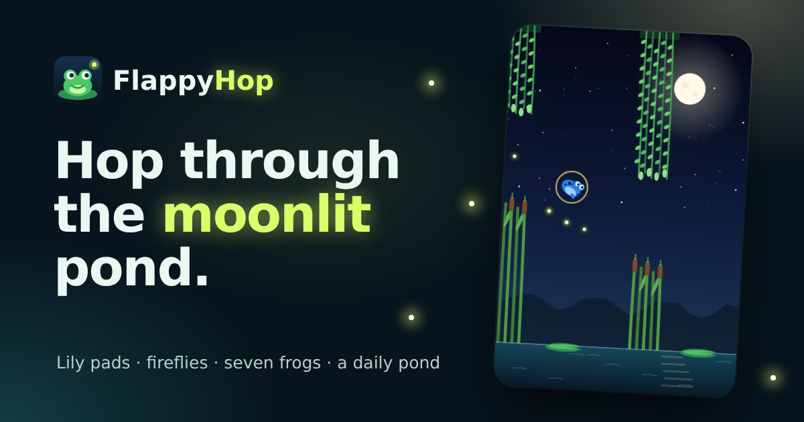

# FlappyHop

A free one-tap game about a little frog and a moonlit pond.

Play it at **[flappyhop.netlify.app](https://flappyhop.netlify.app)**



## About

Tap and the frog hops. Thread the gaps between hanging willow vines and the reeds growing out of the
water, bounce off lily pads when you fall, and catch fireflies on the way. It's quick to learn, hard
to put down, and it runs right in the browser with nothing to install, no ads in the game and no
account.

## Features

- **One button.** Tap, click, or press Space, ↑ or W to hop. P or Esc pauses.
- **Lily pads.** Falling into the pond ends a run, unless there's a lily pad under you: it bounces
  you back up, once, and then sinks.
- **Fireflies and combos.** Catch fireflies in a quick chain for a combo. Every firefly is saved,
  and they unlock new frogs.
- **Glow bugs.** A rare golden bug that shields you from your next crash.
- **Dragonflies.** From 15 gaps on, they dart across the pond faster than it scrolls.
- **A changing sky.** Dusk, twilight, night and the northern lights, with the pond speeding up and
  the gaps narrowing as you go.
- **Seven frogs** to unlock, from Pip the pond frog to Nova, speckled with stars.
- **Daily pond.** One course a day, the same for everyone, with a goal to reach and a streak to
  keep. Share your score without spoiling the course.
- **Stats and achievements**, including a breakdown of how your runs end.
- **Drawn in code.** The pond, the frogs and everything in it are drawn on an HTML canvas, and the
  sounds are made with the Web Audio API, so there are no images or audio files to download.
- **Night and day themes**, reduced motion, and sharp graphics on high-density screens.

## Run it locally

You need [Node.js](https://nodejs.org/) 20 or newer.

```bash
git clone https://github.com/shoaibmarif/flappyhop.git
cd flappyhop
npm install
npm run dev
```

Then open <http://localhost:5173>.

### Scripts

| Command | What it does |
| --- | --- |
| `npm run dev` | Start the development server with hot reload |
| `npm run build` | Type-check and build the production site into `dist/` |
| `npm run preview` | Serve the production build locally |
| `npm test` | Run the tests (Vitest) |

The production build also writes a separate HTML file for every page (each with its own title,
description, social preview and structured data), plus `sitemap.xml`, `robots.txt`, `404.html` and
Netlify's `_redirects` and `_headers`.

## Project structure

```text
src/
  game/world.ts       The rules: a pure step function for the frog, gaps, pads, fireflies and dragonflies
  game/render.ts      Draws the pond on a canvas
  game/progress.ts    Frogs, stats, achievements and the daily pond
  hooks/usePond.ts    The game loop: input, timing, sounds
  components/game/    The game screen and frog portraits
  components/         Layout, dialogs and small UI pieces
  context/            Settings, stats and notifications shared across the app
  pages/              One component per page
  seo/                Site config, per-page SEO metadata and structured data
  utils/              Sounds and saved data
  __tests__/          Engine, progress, hosting and render tests for every page
scripts/seoPlugin.ts  Build step for per-page HTML, the sitemap and Netlify routing
```

Good places to start:

- **Physics and difficulty:** the constants at the top of `src/game/world.ts`
- **Frogs and achievements:** `src/game/progress.ts`
- **Colours and fonts:** the tokens at the top of `src/index.css`
- **Name, domain and links:** `src/seo/site.ts`

## Tech stack

React 19, TypeScript, Vite, Tailwind CSS 4, React Router, HTML canvas, the Web Audio API and Vitest.
Hosted on Netlify.

## Deploying

Connect the repository to Netlify. `netlify.toml` sets the build command (`npm run build`) and the
publish directory (`dist`). Routing and caching rules are generated by the build. If you use a
different domain, update `url` in `src/seo/site.ts`.

## Contributing

Bug reports and ideas for new frogs or pond creatures are welcome. Please
[open an issue](https://github.com/shoaibmarif/flappyhop/issues) first for anything big, and run
`npm test` and `npm run build` before sending a pull request.

## Author

Made by **Shoaib Arif**

- Portfolio: [shoaibarif.vercel.app](https://shoaibarif.vercel.app/)
- LinkedIn: [linkedin.com/in/shoaibmarif](https://www.linkedin.com/in/shoaibmarif/)
- GitHub: [@shoaibmarif](https://github.com/shoaibmarif)
- Email: [shoaibmuhammadarif@gmail.com](mailto:shoaibmuhammadarif@gmail.com)
